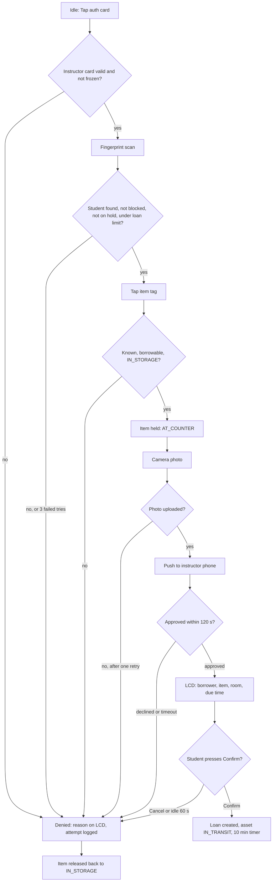
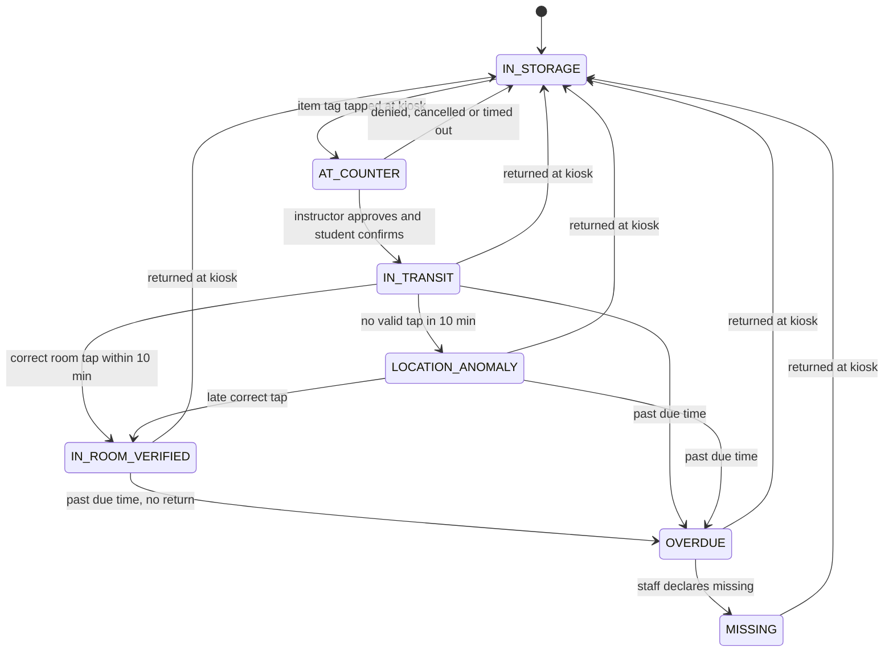

# TAMS flow: borrow, room check-in, overdue and return

> **Reminder.** When all the features below are implemented, review this file, `docs/PRD-GAP-LOG.md` and `docs/FLOW.md` before the team meeting where hardware and web confirm the flow. Update the Status lines in the gap log first.

What the PRD specifies, from the counter kiosk to the room and back. Section numbers refer to the PRD (`../TAMS PRD ...md`): F1 (checkout), F3 (room stations), F6 (penalties), §4.2 (lifecycle), §5.1 (user stories), §6.2 (kiosk protocol), §7.2 (enumerations). Backend behaviour was checked against the code on `dev`. Diagrams are Mermaid and render on GitHub.

## 0. Answers to the common mix-ups

- **The card tapped first is the instructor's card, not the student's.** Students have no account and no card. They borrow with their fingerprint plus an instructor's card that the instructor lends them (US-01).
- **Order at the counter:** instructor card → fingerprint → **item tag** → **photo** → instructor approval on the phone → student presses Confirm. The item scan comes in the **middle** (third), and the photo is **after** the item scan, not before.
- **Return is different:** no card and no instructor. The student scans their fingerprint, then the item tag (US-03).
- **The room tap is separate.** After Confirm the borrower has 10 minutes to tap the item at the destination room's wall station.

## 1. Borrowing at the counter kiosk (F1)

| # | Step (kiosk screen) | What happens | Denied when | Session status |
|---|---|---|---|---|
| 1 | Idle: "TAMS Counter / Tap auth card" | Waiting | | none |
| 2 | **Instructor's RFID card** tapped | Backend opens a session for that instructor | Card unknown, inactive, lost or revoked; instructor under approval freeze | AWAITING_FINGERPRINT |
| 3 | **Fingerprint** on the sensor | Backend matches 1:N against enrolled students | Not recognized after 3 tries; student inactive, **blocked** (2 marks) or **on hold**; loan limit reached | AWAITING_ASSET |
| 4 | **Item tag** tapped | Item is held at the counter, status AT_COUNTER | Unknown tag; not borrowable; status not IN_STORAGE | AWAITING_PHOTO |
| 5 | **Photo** by the counter camera | JPEG uploaded to the session | Photo cannot be captured or uploaded after one retry | AWAITING_APPROVAL |
| 6 | "Waiting for instructor approval" | Push to the instructor's phone (within 3 s): student name and photo, item, destination room, class length | Instructor declines, or no answer in **120 s** | AWAITING_APPROVAL |
| 7 | Instructor picks the room and class length (1.5, 2, 2.5 or 3 h) and taps Approve | The kiosk learns the result by 2-second polling | | AWAITING_CONFIRM |
| 8 | Confirm screen: borrower, item, room, due time | Student presses **Confirm** (or **Cancel**) | Cancel, or idle for **60 s** between steps | COMPLETED |
| 9 | "Borrowed! Tap item at room door within 10 minutes" | **Loan created**, asset becomes IN_TRANSIT, 10-minute timer starts, due time set | | |

Rules that apply throughout:
- Any denial shows a reason on the LCD and is logged (FR-1.6). There is no override (FR-1.2).
- The loan is created only after **both** the instructor's approval and the student's Confirm (FR-1.5).
- Due time = checkout + class length + grace (15 min default). At most 3 h 30 min.
- The kiosk holds no credentials and talks to the API by station code and a short-lived session (FR-1.4).

### 1b. Several items in one checkout (when "max items per transaction" is above 1)
Steps 4 to 5 above repeat: the student taps an item, the LCD shows its name, condition, the count and "Scan item or OK". **OK (Confirm)** moves on to the photo, **X (Cancel)** undoes the last item, and reaching the limit moves on by itself. One photo, one approval and one final Confirm cover all items. Details and LCD text: `docs/PRD-GAP-LOG.md`, gap S1.

## 2. At the room: the 10-minute tap (F3)

The borrower walks to the destination room and taps the item on the wall station. The station sends `POST /api/stations/{code}/scans` and shows the result by LED and buzzer within 2 s.

| Case | Backend result | Station feedback |
|---|---|---|
| Correct room, within 10 min | IN_TRANSIT → **IN_ROOM_VERIFIED**, timer stopped | Green LED and chime |
| Correct room, after 10 min | LOCATION_ANOMALY → IN_ROOM_VERIFIED, anomaly marked "late arrival, resolved"; the warning already issued stays | Green LED and chime |
| Wrong room | Status unchanged, **WRONG_ROOM** anomaly raised, alert pushed | Red strobe and error tone |
| No active loan for that item | **UNBORROWED_TAP** anomaly logged | Red strobe and error tone |
| Unknown tag | Scan logged, no state change | Red strobe and error tone |

Every scan, valid or not, is stored (FR-3.3). If the 10 minutes pass with no valid tap, the sweeper (every 15 s) raises **TRANSIT_TIMEOUT**, sets LOCATION_ANOMALY, issues a Late Arrival Warning to the student and notifies the instructor and staff (FR-4.3, FR-6.1).

## 3. Returning an item at the counter kiosk (F1, US-03)

No instructor and no card.
1. Student scans their **fingerprint** at the idle kiosk ("or scan finger to return an item").
2. Student taps the **item tag**.
3. If the item has an open loan, the loan closes, the asset becomes IN_STORAGE, and both the borrower and the returner are recorded.
4. LCD: "Returned! / item code / Thank you".

A return closes the loan **from any state**, including OVERDUE and MISSING (§4.2). An item with no open loan is refused.

## 4. Lifecycle and penalties (F6)

| Trigger | Student | Approving instructor |
|---|---|---|
| No tap at the room in 10 min, warnings 1 to 3 | Late Arrival Warning | Notified in the app |
| Same, 4th or later warning | Warning and Non-Compliance Mark | Notified and approval freeze |
| Loan passes its due time (OVERDUE) | Non-Compliance Mark and profile hold | Notified and approval freeze |
| Staff declares the item MISSING | Financial liability (replacement cost); hold stays | Freeze stays |
| 2 Non-Compliance Marks | Borrowing blocked | none |

Only technical staff clear warnings and marks, lift holds and freezes, and settle liabilities, each with a reason (FR-6.8). Everything is written to the audit log (FR-6.10).

## 5. Where the code goes beyond or differs from this

- **DAMAGED items can be borrowed** today; neither flow checks condition. Decided to refuse them (gap log, E6).
- **One item per checkout.** A student cannot borrow several items in one transaction. Decided to make it a staff setting, default 1 (gap S1, E8).
- **Event batch borrowing (F5)** is a separate flow (instructor or flagged staff as coordinator, no fingerprint, no photo, no approval). See `docs/PRD-GAP-LOG.md`.
- **Holds** stay until staff lift them, even after a return (FR-6.5 wording to change).
- The PRD names an ESP32-CAM; the deployment decision uses a USB webcam on the counter computer. The API only receives a JPEG, so the flow is unchanged.
